# Cyberbezpieczeństwo

2026-10-13

## 1. Szyfrowanie historyczne

### Przykład 1

Szyfrowanie Vigenere `ABC` + Szyfrowanie Vigenere `DEF` się odszyfrowuje poprzez Vigenere `DFH`

### Przykład 2

Szyfrowanie Vigenere `ABC` + Szyfrowanie Vigenere `DEFG` się odszyfrowuje poprzez Vigenere `DFHGEGFHFEGI`

### Przykład 3

Szyfrowanie Hill 2x `QDZI` === Szyfrowanie Hill 1x `TUCJ`

## 2. Analiza własności dostępnych algorytmów.

### 2.1 Porównanie entropii tekstów jawnych

| Język     | Tekst                                                                            | Entropia |
| --------- | -------------------------------------------------------------------------------- | -------- |
| Polski    | Bardzo przepraszam, ale niestety nie mowie po polsku.                            | 3.94     |
| Angielski | I am terribly sorry, but unfortunately, I do not speak English.                  | 4.02     |
| Japoński  | Taihen moshiwake gozaimasen ga, zan ne nagara watashi wa nihongo no hanasemasen. | 3.44     |

### 2.2 Porównanie entropii tekstów zaszyfrowanych

1. Polski

| Algorytm szyfrowania | Entropia |
| -------------------- | -------- |
| Brak                 | 3.94     |
| Caesar               | 3.94     |

2. Angielski

| Algorytm szyfrowania | Entropia |
| -------------------- | -------- |
| Brak                 | 4.02     |
| Caesar               | 4.02     |

3. Japoński

| Algorytm szyfrowania | Entropia |
| -------------------- | -------- |
| Brak                 | 3.44     |
| Caesar               | 3.44     |

### 2.3 Histogramy tekstów jawnych

1. Polski
   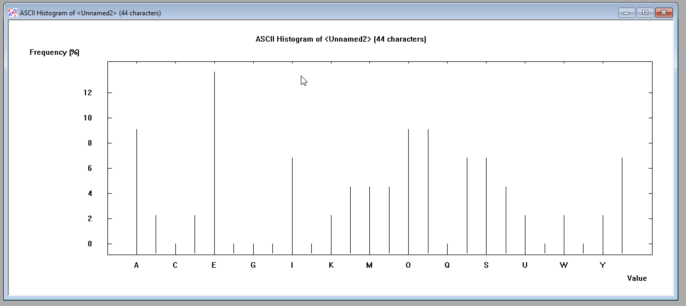
2. Angielski
   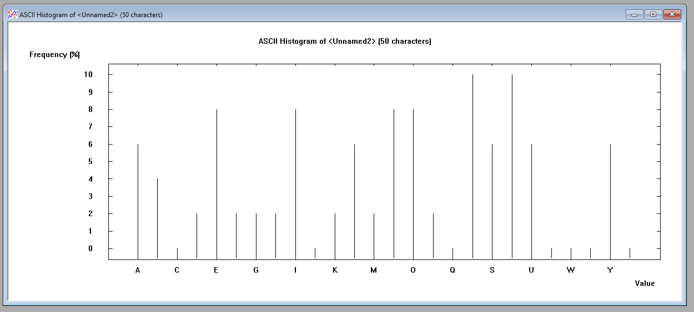
3. Japoński
   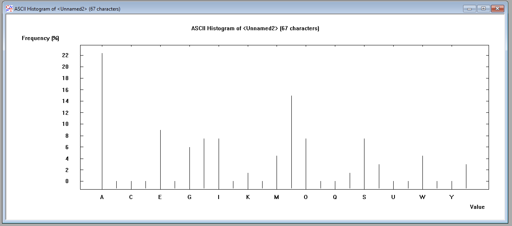

### 2.4 Histogramy tekstów zaszyfrowanych

### 2.5 N-gramy tekstów jawnych

1. Polski

   a. 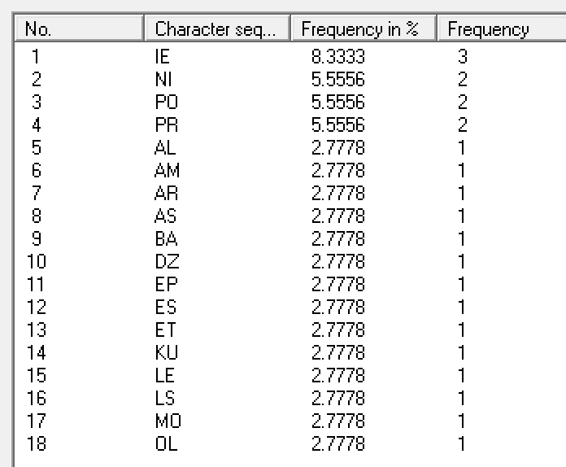
   b. 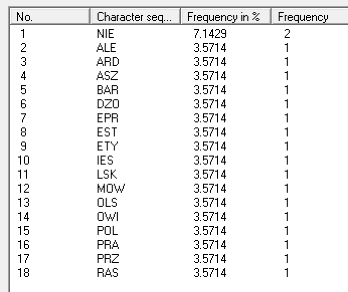
   c. 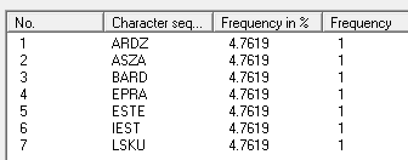

2. Angielski

   a. 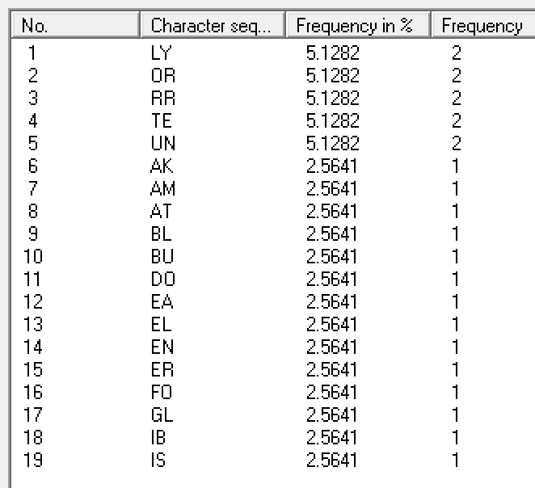
   b. 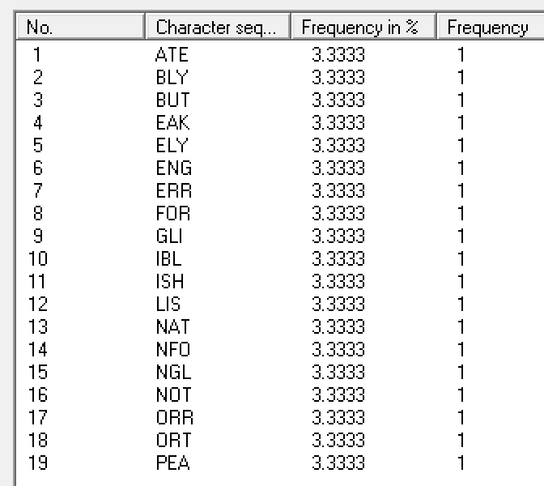
   c. 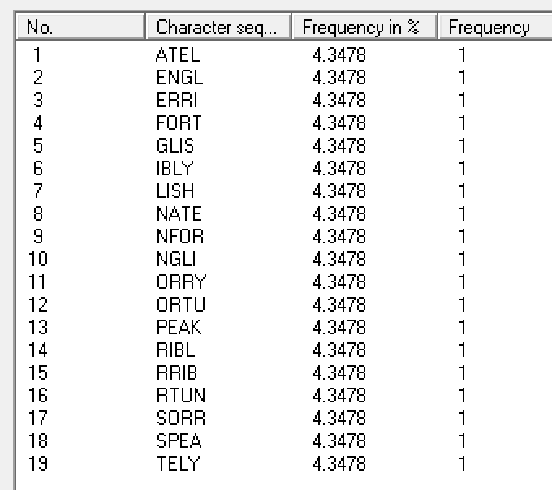

3. Japoński

   a. 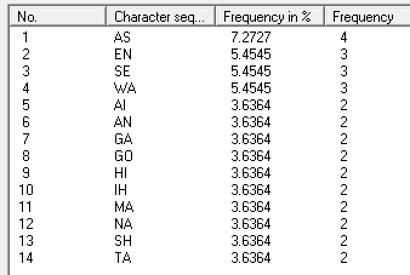
   b. 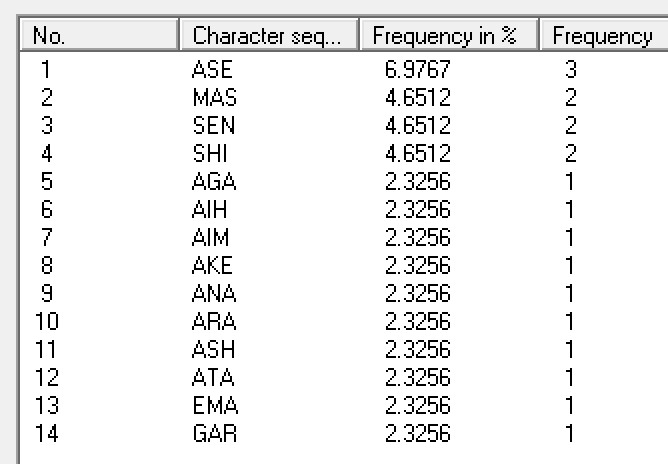
   c. 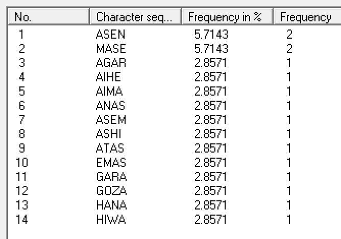
