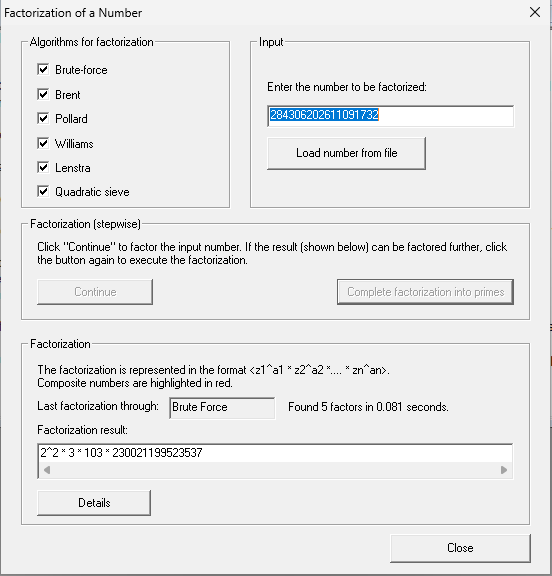
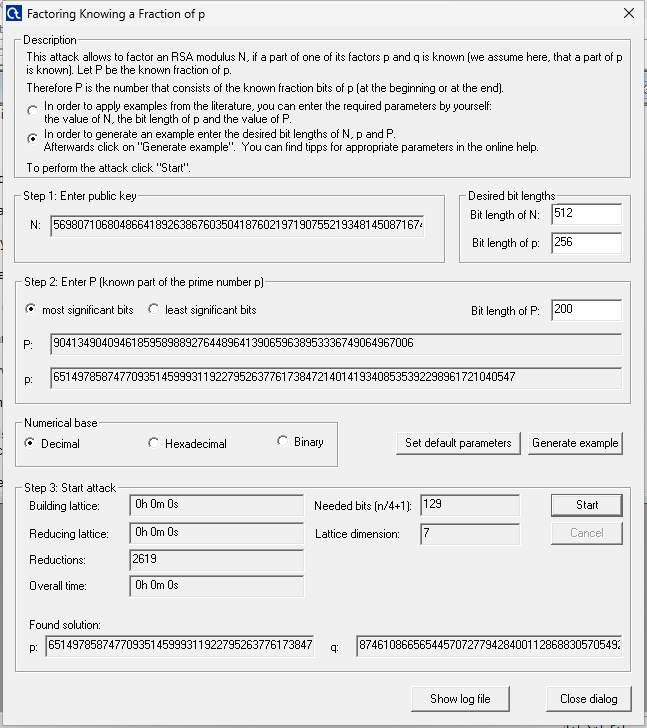

# Cyberbezpieczeństwo laboratorium

2026-11-09

Konrad Guzek grupa 8

## 1. Kryptoanaliza algorytmów symetrycznych

Do wszystkich pomiarów użyto CrypTool 1.4.42 i ataku brute-force z menu `Analysis/Symmetric Encryption (modern)`. Atak przeszukuje klucze pasujące do wzorca, w którym nieznane cyfry szesnastkowe zastępuje się gwiazdką (jedna gwiazdka = 4 bity), odszyfrowuje początek kryptogramu każdym kandydatem i jako najlepsze wybiera odszyfrowanie o najmniejszej entropii. W opcjach analizy (`Options/Analysis Options`) pozostawiono ustawienia domyślne: test entropii na pierwszych 128 B kryptogramu i alfabet wszystkich 256 znaków.

Tekst jawny (406 B, ASCII):

```text
Symmetric block ciphers such as AES and DES protect confidentiality only as long as the key remains
secret. An attacker who does not know any weakness of the algorithm can still try every possible key
and check whether the decrypted text looks like a meaningful message. The cost of such an exhaustive
search grows exponentially with the number of unknown key bits, so each additional bit doubles the work.
```

Tekst zaszyfrowano w trybie CBC kluczem 128-bitowym `3A 7F 12 C4 9B 05 E8 61 D2 4C 77 A0 1E 93 5B F6` algorytmami AES, MARS, RC6, Serpent, Twofish i IDEA, a DES kluczem złożonym z pierwszych 8 bajtów (`3A 7F 12 C4 9B 05 E8 61`). Kryptogram AES ma 416 B i zaczyna się od `01 6C 0D 3F 67 40 07 83 A8 46 0F 2B E7 DF AF 9B`.

### 1.1 Czas odnalezienia pełnego klucza

Przy kluczu złożonym z samych gwiazdek CrypTool od razu podaje szacowany czas pozostały do końca przeszukiwania. Dla klucza 64-bitowego użyto DES (klucz 64-bitowy, z którego 8 bitów to bity parzystości, więc program przeszukuje 56 bitów), dla pozostałych długości AES.

| Długość klucza | Algorytm | Przeszukiwana przestrzeń | Szacowany czas |
| ---: | --- | ---: | ---: |
| 64 bity | DES | 2^56 | 2,4·10^4 lat |
| 128 bitów | AES-128 | 2^128 | 2·10^25 lat |
| 192 bity | AES-192 | 2^192 | 4,1·10^44 lat |
| 256 bitów | AES-256 | 2^256 | 8,7·10^63 lat |

Dla porównania AES-128 z 64 nieznanymi bitami (połowa klucza znana) dawał szacunek 1,1·10^6 lat. Każdy dodatkowy bit podwaja czas, więc przejście ze 128 na 192 bity mnoży go przez 2^64 ≈ 1,8·10^19, co dokładnie widać w tabeli.

### 1.2 Porównanie algorytmów przy kluczu 128-bitowym

Dla każdego algorytmu wykonano pełne przeszukanie 20 nieznanych bitów (wzorzec `3A7F12C49B05E861D24C77A01E9*****`, dla DES `3A7F12C49B0*****`) oraz odczytano szacunek dla pełnego klucza.

| Algorytm | Czas przeszukania 20 bitów [s] | Szacunek dla pełnego klucza | Znaleziony klucz poprawny |
| --- | ---: | ---: | --- |
| AES (Rijndael) | 2,40 | 2·10^25 lat | tak |
| RC6 | 2,42 | 1,7·10^25 lat | tak |
| MARS | 3,68 | 3,3·10^25 lat | tak |
| Twofish | 4,09 | 3,4·10^25 lat | tak |
| Serpent | 6,16 | 5,5·10^25 lat | tak |
| IDEA | 26,05 | 1,9·10^26 lat | tak |
| DES (56 bitów) | 1,96 | 2,4·10^4 lat | równoważny (`3A7F12C49B04E860`) |

Czas pełnego przeszukania przy tej samej długości klucza zależy tylko od szybkości jednej operacji deszyfrowania. AES i RC6 są najszybsze, Serpent i Twofish wolniejsze ok. 1,5–2,5 raza, a IDEA (w implementacji CrypTool) ponad 10 razy. Różnice te nie mają praktycznego znaczenia: dla każdego algorytmu ze 128-bitowym kluczem czas jest rzędu 10^25 lat.

### 1.3 Czas przy rosnącej liczbie nieznanych bitów

AES-128, nieznane bity na końcu klucza. Do 24 bitów wykonano pełne przeszukanie i zmierzono czas od uruchomienia do pojawienia się listy wyników, dla większej liczby bitów odczytano szacunek CrypTool.

| Nieznane bity | Gwiazdki | Wzorzec klucza | Czas | Rodzaj |
| ---: | ---: | --- | ---: | --- |
| 4 | 1 | `3A7F12C49B05E861D24C77A01E935BF*` | 0,60 s | pomiar |
| 8 | 2 | `3A7F12C49B05E861D24C77A01E935B**` | 0,59 s | pomiar |
| 12 | 3 | `3A7F12C49B05E861D24C77A01E935***` | 0,58 s | pomiar |
| 16 | 4 | `3A7F12C49B05E861D24C77A01E93****` | 0,57 s | pomiar |
| 20 | 5 | `3A7F12C49B05E861D24C77A01E9*****` | 2,76 s | pomiar |
| 24 | 6 | `3A7F12C49B05E861D24C77A01E******` | 33,34 s | pomiar |
| 28 | 7 | `3A7F12C49B05E861D24C77A01*******` | 8 min 18 s | szacunek |
| 32 | 8 | `3A7F12C49B05E861D24C77A0********` | 2 h 13 min | szacunek |
| 40 | 10 | `3A7F12C49B05E861D24C77**********` | 23,8 dnia | szacunek |
| 48 | 12 | `3A7F12C49B05E861D24C************` | 17 lat | szacunek |
| 64 | 16 | `3A7F12C49B05E861****************` | 1,1·10^6 lat | szacunek |

Do 16 bitów czas jest stały (ok. 0,6 s), bo przeszukanie 65 536 kluczy trwa ułamek sekundy, a dominuje otwarcie okna wyników. Od 20 bitów czas rośnie ok. 12–16 razy na każde 4 bity, zgodnie z oczekiwanym `2^4 = 16`. Z pomiaru dla 24 bitów wynika szybkość ok. `2^24 / 33,3 s ≈ 5,0·10^5` kluczy na sekundę, a z szacunków dla 28 i 32 bitów ok. `5,4·10^5` kluczy/s.

### 1.4 Wpływ pozycji nieznanych bitów

| Nieznane bity | Pozycja | Wzorzec klucza | Czas [s] |
| ---: | --- | --- | ---: |
| 20 | koniec | `3A7F12C49B05E861D24C77A01E9*****` | 2,76 |
| 20 | początek | `*****2C49B05E861D24C77A01E935BF6` | 2,76 |
| 20 | środek | `3A7F12C49B05E*****4C77A01E935BF6` | 2,35 |
| 20 | rozproszone | `*A7F12C4*B05E861*24C77A0*E935BF*` | 2,89 |
| 24 | koniec | `3A7F12C49B05E861D24C77A01E******` | 33,34 |
| 24 | początek | `******C49B05E861D24C77A01E935BF6` | 33,27 |
| 24 | środek | `3A7F12C49B05E******C77A01E935BF6` | 33,37 |
| 24 | rozproszone | `*A7F12*49B05*861D2*C77A0*E935BF*` | 33,63 |

Pozycja nieznanych bitów nie wpływa na czas: liczba kandydatów wynosi zawsze `2^n`, a sprawdzenie każdego klucza kosztuje tyle samo. Różnice rzędu dziesiątych części sekundy mieszczą się w rozrzucie pomiaru. W każdym przypadku znaleziono poprawny klucz.

### 1.5 Jakość działania algorytmu łamiącego

**AES, 24 nieznane bity.** Wszystkie przebiegi na kryptogramie 416 B (cztery pozycje gwiazdek z tabeli 1.4 oraz wszystkie pomiary z 1.3) zwróciły dokładnie klucz `3A7F12C49B05E861D24C77A01E935BF6`, a odszyfrowany tekst był poprawny.

**DES, 24 nieznane bity** (6 gwiazdek, kryptogram 408 B):

| Wzorzec klucza | Czas [s] | Znaleziony klucz | Zgodny z użytym (`3A7F12C49B05E861`) |
| --- | ---: | --- | --- |
| `3A7F12C49B******` | 24,82 | `3A7F12C49B04E860` | równoważny |
| `******C49B05E861` | 24,63 | `3A7E12C49B05E861` | równoważny |
| `3A7F1******5E861` | 24,67 | `3A7F12C49A05E861` | równoważny |

DES za każdym razem odszyfrował tekst poprawnie, ale zwrócony klucz różnił się od użytego na najmłodszych bitach niektórych bajtów (`05→04`, `61→60`, `7F→7E`, `9B→9A`). To bity parzystości: DES używa tylko 7 bitów z każdego bajtu klucza, więc klucze różniące się wyłącznie tymi bitami są równoważne. Program podaje pierwszy znaleziony z nich, a 6 gwiazdek oznacza w praktyce 21 efektywnych bitów (ok. 2,1 mln kluczy w 24,7 s, czyli ok. 85 tys. kluczy/s, ok. 6 razy wolniej niż AES).

**Krótki kryptogram.** Tekst `Meet at 7 pm.` (13 B) zaszyfrowano AES-128 tym samym kluczem, co dało kryptogram 16 B: `8A C7 58 C2 E9 76 AA 72 47 42 03 CF 57 74 05 E1`.

| Nieznane bity | Wzorzec klucza | Czas [s] | Znaleziony klucz | Poprawny |
| ---: | --- | ---: | --- | --- |
| 8 | `3A7F12C49B05E861D24C77A01E935B**` | 0,65 | `3A7F12C49B05E861D24C77A01E935BF6` | tak |
| 16 | `3A7F12C49B05E861D24C77A01E93****` | 0,59 | `3A7F12C49B05E861D24C77A01E935BF6` | tak |
| 20 | `3A7F12C49B05E861D24C77A01E9*****` | 1,49 | `3A7F12C49B05E861D24C77A01E901054` | nie |
| 24 | `3A7F12C49B05E861D24C77A01E******` | 14,21 | `3A7F12C49B05E861D24C77A01E45E755` | nie |

Przy jednym bloku szyfrogramu entropia jest liczona tylko z 16 bajtów. Wśród ok. miliona kandydatów zawsze znajdzie się jakieś losowe odszyfrowanie o przypadkowo niższej entropii niż prawdziwy tekst, więc od 20 nieznanych bitów program wskazywał błędny klucz. Przy kryptogramie 416 B (128 B używanych do testu) takiego problemu nie było.

Odpowiedzi na pytania z 1.5:

- Dla AES przy 24 nieznanych bitach i dostatecznie długim kryptogramie otrzymano za każdym razem poprawny klucz. Dla DES otrzymano zawsze klucz poprawny funkcjonalnie, ale nie zawsze identyczny z użytym, bo różnił się bitami parzystości.
- Liczba szukanych bitów wpływa na jakość: im więcej kandydatów, tym większa szansa, że któryś błędny klucz da przypadkowo niską entropię. Przy długim kryptogramie nie miało to znaczenia do 24 bitów, przy 16-bajtowym błędy pojawiły się już od 20 bitów.
- Pozycja nieznanych bitów nie wpływa na jakość: dla AES wszystkie pozycje dały poprawny klucz, dla DES wszystkie pozycje dały klucz równoważny, a to, czy różni się od użytego, zależy tylko od tego, czy gwiazdki obejmują bity parzystości.

### Wnioski (pytania 1.6 do 1.8)

**1.6.** Z pełnego przeszukania 24 nieznanych bitów AES w 33,34 s wynika szybkość:

```text
v = 2^24 / 33,34 s = 16 777 216 / 33,34 s ≈ 5,03·10^5 kluczy/s
w ciągu godziny: 5,03·10^5 · 3600 ≈ 1,81·10^9 kluczy ≈ 2^30,75
```

Komputer jest więc w stanie przeszukać w godzinę ok. 30 bitów klucza (2^30 ≈ 1,07·10^9 kluczy w ok. 36 min, 2^31 w ok. 71 min). Pełne przeszukanie AES-128:

```text
t = 2^128 / v = 3,40·10^38 / 5,03·10^5 ≈ 6,76·10^32 s ≈ 2,1·10^25 lat
```

Wynik zgadza się z szacunkiem CrypTool (2·10^25 lat) i jest ok. 10^15 razy dłuższy niż wiek Wszechświata (1,4·10^10 lat). Średnio klucz znajduje się po przeszukaniu połowy przestrzeni, co niczego nie zmienia. Z punktu widzenia ataku brute-force AES-128 jest bezpieczny, choć sam czas łamania nie wystarcza do uznania algorytmu za bezpieczny, bo trzeba jeszcze wykluczyć ataki szybsze niż przeszukanie (dla AES najlepsze znane ataki zmniejszają nakład tylko o ok. 2 bity).

**1.7.** Miliard takich komputerów sprawdza `V = 10^9 · 5,03·10^5 ≈ 5,03·10^14` kluczy/s. Przez 1000 lat (3,156·10^10 s) daje to:

```text
V · t = 5,03·10^14 · 3,156·10^10 ≈ 1,59·10^25 ≈ 2^83,7 kluczy
```

Aby pełne przeszukanie trwało dłużej niż 1000 lat, klucz musi mieć co najmniej 84 bity (2^84 ≈ 1,9·10^25 kluczy, ok. 1200 lat). NIST (SP 800-57, SP 800-131A) wymaga obecnie co najmniej 112 bitów bezpieczeństwa, a dla ochrony danych po 2030 r. zaleca 128 bitów, czyli AES-128 lub dłuższy. Zalecenie jest wyraźnie wyższe od oszacowania, bo: wyspecjalizowany sprzęt (ASIC, FPGA, GPU) sprawdza klucze o wiele rzędów wielkości szybciej niż CrypTool na jednym rdzeniu maszyny wirtualnej, moc obliczeniowa rośnie z czasem, dane mają być chronione przez dziesięciolecia, potrzebny jest zapas na postęp kryptoanalizy, a algorytm Grovera na komputerze kwantowym zmniejszałby efektywną długość klucza o połowę (stąd zalecenia AES-256 dla danych długoterminowych).

**1.8.** Tak. Długość kryptogramu nie zmienia liczby kluczy do sprawdzenia, ale wpływa na to, czy da się rozpoznać właściwy klucz. Dla bardzo krótkiego kryptogramu (16 B) wiele kluczy daje odszyfrowanie wyglądające „równie dobrze” i atak wskazał błędny klucz już przy 20 nieznanych bitach, podczas gdy dla 416 B klucz był zawsze poprawny. Odległość jednoznaczności (unicity distance) mówi, ile szyfrogramu potrzeba, żeby tylko jeden klucz dawał sensowny tekst. Dla AES-128 i tekstu ASCII to zaledwie kilkadziesiąt bajtów, więc w praktyce większy kryptogram ułatwia weryfikację klucza. Krótki kryptogram jest też szybciej przeszukiwany (24 bity w 14,2 s zamiast 33,3 s), bo każdy kandydat odszyfrowuje mniej danych. Sama długość kryptogramu nie pozwala natomiast złamać nowoczesnego szyfru, jeśli klucz ma 128 lub więcej bitów.

## 2. Kryptoanaliza algorytmów asymetrycznych

### 2.1 Rozkład liczby na czynniki pierwsze

Liczbę utworzono z numeru indeksu, roku, miesiąca, dnia, godziny i minuty wykonania zadania:

| Numer indeksu | Rok | Miesiąc | Dzień | Godzina | Minuta |
| --- | --- | --- | --- | --- | --- |
| 284306 | 2026 | 11 | 09 | 17 | 32 |

```text
n = 284306 2026 11 09 17 32 = 284306202611091732   (18 cyfr, ok. 2^58)
```

W `Indiv. Procedures/RSA Cryptosystem/Prime Number Test` test Millera-Rabina od razu wykazał, że liczba jest złożona (jest zresztą parzysta). Przycisk `Factorize number` przeniósł ją do okna `Factorization of a Number`, gdzie zaznaczone były wszystkie metody (brute-force, Brent, Pollard, Williams, Lenstra, sito kwadratowe). `Complete factorization into primes` dało wynik:

```text
284306202611091732 = 2^2 · 3 · 103 · 230021199523537
```

Program znalazł 5 czynników (licząc krotność dwójki) w 0,081 s, a ostatnim użytym algorytmem był brute-force: liczba ma małe dzielniki, które wystarczy sprawdzić po kolei, a pozostały czynnik `230021199523537` (15 cyfr) jest pierwszy.



Dla porównania tym samym oknem rozłożono liczby półpierwsze `N = p · q` o dwóch czynnikach podobnej długości, takich jak w module RSA:

| Cyfry N | Bity N | N | Czynniki | Ostatnia metoda | Czas [s] |
| ---: | ---: | --- | --- | --- | ---: |
| 16 | 53 | `6924840186918629` | `81334723 · 85140023` | Brent | 0,163 |
| 19 | 63 | `4968495006777680821` | `1144297333 · 4341961537` | sito kwadratowe | 0,085 |
| 24 | 77 | `101481758411612589210313` | `133334355881 · 761107351073` | sito kwadratowe | 0,129 |
| 30 | 97 | `130852754800825853838863948641` | `361696082163601 · 361775427641041` | sito kwadratowe | 0,530 |
| 36 | 117 | `156542283157465096696035106403667647` | `320689069306753813 · 488143495180140419` | sito kwadratowe | 0,756 |
| 40 | 132 | `4130744293224119315901623942562680789683` | `44851384475319277963 · 92098479044658616441` | sito kwadratowe | 2,314 |
| 44 | 144 | `21736989673752333324064653508575677572235801` | `2722736717508579781979 · 7983507745707637105819` | Lenstra (ECM) | 2,422 |
| 50 | 164 | `16574103800383576902758939287964964463245649124389` | `1692698443639291982187527 · 9791527760106725467317107` | sito kwadratowe | 15,782 |
| 56 | 185 | `42702392195229985335946747038846626014424256064783553989` | `4918031773032114395151380053 · 8682821536328277351716936113` | sito kwadratowe | 63 (1 min 3 s) |
| 60 | 197 | `172367471682698959690911767062330168643952260536431662673247` | `326710685121493788879714491587 · 527584433360668102813861008181` | sito kwadratowe | 114 (1 min 54 s) |
| 66 | 219 | `451331171999440936791349614587859410186593177345810166822649143483` | `467826121433462009441313494682727 · 964741281689275837249215611737229` | sito kwadratowe | 632 (10 min 32 s) |

Do ok. 40 cyfr rozkład trwa ułamki sekund, potem czas rośnie coraz szybciej: przejście z 50 na 60 cyfr wydłużyło go ok. 7 razy, a z 60 na 66 cyfr ponad 5 razy. Złożoność sita kwadratowego jest podwykładnicza, `exp((1+o(1))·sqrt(ln N · ln ln N))`, ale i tak bardzo szybko rośnie z długością N. Na tej samej maszynie 66 cyfr (219 bitów) to już ponad 10 minut, a moduł RSA-2048 ma 617 cyfr.

### 2.2 Czas generowania liczb pierwszych

W `Indiv. Procedures/RSA Cryptosystem/Generate Prime Numbers` wybrano losowanie dwóch liczb pierwszych `p` i `q` z tego samego przedziału (`Both are equal`) testem Millera-Rabina. Przedział `[2^(k-1), 2^k]` obejmuje wszystkie liczby k-bitowe, więc zwiększanie k zwiększa zarówno wartości, jak i szerokość przeglądanego przedziału. Czas mierzono od kliknięcia `Generate prime numbers` do pojawienia się wyników.

| Przedział | Bity | Przykładowe wylosowane `p` (początek) | Czas [s] |
| --- | ---: | --- | ---: |
| `[2^31, 2^32]` | 32 | `4271795867` | < 0,7 |
| `[2^63, 2^64]` | 64 | `9919347432835027549` | < 0,7 |
| `[2^127, 2^128]` | 128 | `224660824325855405676530487876374394143` | < 0,7 |
| `[2^255, 2^256]` | 256 | `770589666250272114736863595173695596297…` | < 0,7 |
| `[2^511, 2^512]` | 512 | `128881306136450913511669025237052950778…` | < 0,7 |
| `[2^767, 2^768]` | 768 | `112014143318085382640527972579001412538…` | 0,8 |
| `[2^1023, 2^1024]` | 1024 | `144304405878377901154722929829305338208…` | 3,0 |
| `[2^1535, 2^1536]` | 1536 | `192853248936055305279911970308805417737…` | 3,3 |
| `[2^2047, 2^2048]` | 2048 | `232152583050177935133453287314074759828…` | 15,0 |
| `[2^3071, 2^3072]` | 3072 | `291120255887973549166465450386332786430…` | 44,1 |

Do ok. 768 bitów wynik pojawia się praktycznie natychmiast (podane 0,7 s to głównie czas reakcji okna). Powyżej czas wyraźnie rośnie: 1024 → 2048 bitów to ok. 5 razy dłużej, 2048 → 3072 bitów ok. 3 razy dłużej. Wynika to z dwóch efektów. Liczb pierwszych w okolicy `x` jest ok. `1/ln x`, więc dla k-bitowych liczb trzeba średnio sprawdzić ok. `k·ln2/2` nieparzystych kandydatów (ok. 355 dla 1024 bitów, 710 dla 2048 bitów). Jednocześnie pojedynczy test Millera-Rabina to potęgowanie modularne o koszcie ok. `k^3`. Łącznie czas rośnie mniej więcej jak `k^4` (w pomiarach nieco wolniej, a duży rozrzut wynika z losowego trafienia na liczbę pierwszą). Generowanie liczb pierwszych pozostaje jednak wielokrotnie szybsze niż faktoryzacja: 2048-bitowy moduł RSA powstaje w kilkanaście sekund, a liczbę 219-bitową rozkładano ponad 10 minut.

### 2.3 Faktoryzacja modułu N z podpowiedzią

Użyto `Indiv. Procedures/RSA Cryptosystem/Lattice-Based Attacks on RSA/Factoring with a Hint` w trybie generowania przykładów: program losuje `N = p·q` o zadanej długości, liczbę pierwszą `p` o zadanej długości i ujawnia jej najstarsze (MSB) lub najmłodsze (LSB) bity jako `P`. Atak (metoda Coppersmitha) buduje kratę z `N` i `P`, redukuje ją algorytmem LLL i z krótkiego wektora odczytuje brakującą część `p`. Wymagana liczba znanych bitów to `n/4 + 1`, gdzie n to długość N.

| N [bit] | p [bit] | Znane bity P | Wymagane (n/4+1) | Wymiar kraty | Redukcje | Czas | Wynik |
| ---: | ---: | --- | ---: | ---: | ---: | --- | --- |
| 200 | 100 | 80 (MSB) | 51 | 6 | 482 | 0 s | sukces |
| 200 | 100 | 70 (MSB) | 51 | 10 | 3 012 | 0 s | sukces |
| 200 | 100 | 60 (MSB) | 51 | 19 | 27 673 | 0 s | sukces |
| 200 | 100 | 60 (LSB) | 51 | 20 | 54 999 | 5 s | sukces |
| 200 | 100 | 56 (MSB) | 51 | 33 | 102 251 | 12 s | sukces |
| 200 | 100 | 54 (MSB) | 51 | 49 | 294 340 | 2 min 8 s | sukces |
| 200 | 100 | 52 (MSB) | 51 | 99 | 401 036 | > 30 min | przerwano bez wyniku |
| 200 | 100 | 50 (MSB) | 51 | – | – | – | odrzucone: za mało znanych bitów |
| 512 | 256 | 200 (MSB) | 129 | 7 | 2 537 | 0 s | sukces |
| 512 | 256 | 160 (MSB) | 129 | 15 | 31 699 | 2 s | sukces |
| 512 | 256 | 140 (MSB) | 129 | 42 | > 105 297 | > 3 min | przerwano bez wyniku |
| 1024 | 512 | 400 (MSB) | 257 | 7 | 5 155 | 1 s | sukces |
| 1024 | 512 | 300 (MSB) | 257 | 23 | 252 351 | 2 min 2 s | sukces |
| 2048 | 1024 | 800 (MSB) | 513 | 7 | 10 405 | 0 s | sukces |
| 2048 | 1024 | 600 (MSB) | 513 | 23 | > 67 208 | > 3 min | przerwano bez wyniku |

Przykład dla N = 512 bitów:

```text
N = 5698071068048664189263867603504187602197190755219348145087167…  (512 bitów)
P = 904134904094618595898892764489641390659638953336749064967006   (200 najstarszych bitów p)
p = 6514978587477093514599931192279526377617384721401419340853539…  (znalezione)
```



Skuteczność zależy przede wszystkim od zapasu znanych bitów ponad próg `n/4`. Poniżej progu atak w ogóle nie jest możliwy (program odrzuca P=50 przy N=200), tuż nad progiem jest teoretycznie możliwy, ale potrzebna krata ma bardzo duży wymiar (99 dla 52 bitów) i redukcja LLL trwa dziesiątki minut. Przy zapasie kilkudziesięciu bitów wymiar kraty spada do 6–7 i wynik pojawia się natychmiast, niezależnie od tego, czy N ma 200, czy 2048 bitów. Długość N wpływa na czas głównie przez rozmiar liczb w kracie: przy tym samym wymiarze 23 atak dla N=1024 trwał 2 minuty, a dla N=2048 nie skończył się w 3 minuty. Znajomość bitów najmłodszych (LSB) też wystarcza, choć przy tej samej liczbie bitów potrzebna była nieco większa krata i dłuższy czas niż dla MSB.

### Wnioski (pytania 2.5 do 2.7)

**2.5.** W pomiarach z 2.1 liczba 50-cyfrowa (164 bity) rozkładała się w 16 s, a 66-cyfrowa (219 bitów) w ok. 10,5 min na jednym rdzeniu. Rekordowy publicznie rozłożony moduł RSA ma 829 bitów (RSA-250, 2020, ok. 2700 lat rdzenia CPU, metoda GNFS). Moduł 1024-bitowy uważa się dziś za zagrożony dla dobrze wyposażonego atakującego i NIST wycofał go w 2013 r. Minimalna rozsądna długość to obecnie 2048 bitów (ok. 112 bitów bezpieczeństwa), a dla danych chronionych po 2030 r. zalecane jest 3072 bity (128 bitów bezpieczeństwa). Dla ochrony długoterminowej stosuje się 4096 bitów. Długości te zakładają brak komputerów kwantowych: algorytm Shora rozkłada N w czasie wielomianowym, dlatego NIST planuje wycofanie RSA na rzecz kryptografii postkwantowej (ML-KEM, ML-DSA) do 2035 r.

**2.6.** Tak. Atak z 2.3 działa także dla N=2048 bitów: przy znanych 800 z 1024 bitów czynnika p moduł został rozłożony natychmiast, a teoretycznie wystarcza nieco ponad połowa bitów p (n/4 + 1 = 513 bitów). Bezpieczna długość modułu chroni więc tylko wtedy, gdy żadna istotna część p nie wycieknie. Taki wyciek może wynikać z ataków bocznokanałowych (pomiary czasu, poboru prądu, cold boot), wadliwego generatora liczb losowych (np. podatność ROCA w kartach Infineon z 2017 r. dawała przewidywalną strukturę p i q) albo częściowego ujawnienia klucza prywatnego. Długość N nie zastępuje ochrony samego klucza i jego generowania.

**2.7.** Atak na wiadomości stereotypowe (Coppersmith) pozwala odzyskać nieznaną część wiadomości `m`, jeśli reszta jest znana, a szyfrowanie odbywa się bez losowego dopełnienia (textbook RSA) z małym wykładnikiem publicznym, np. `e = 3`. Zagrożone są więc systemy, które szyfrują wiadomości o przewidywalnym formacie (np. `Twoje hasło to: ********`, nagłówki, stałe szablony, klucze sesyjne doklejane do znanych danych) bezpośrednio wzorem `c = m^e mod N`. Atak działa, gdy nieznana część jest krótsza niż ok. `n/e` bitów, np. dla e=3 i N 2048 bitów do ok. 680 bitów. Zagrożenie występuje też przy wysyłaniu tej samej lub podobnej wiadomości do wielu odbiorców z małym e (atak Håstada) oraz przy dopełnieniu deterministycznym. Ochroną jest stosowanie losowego dopełnienia OAEP (lub co najmniej PKCS#1 v1.5 z pełną weryfikacją), wykładnika `e = 65537` i używanie RSA do szyfrowania tylko losowych kluczy sesyjnych, a nie wiadomości o znanej strukturze.

