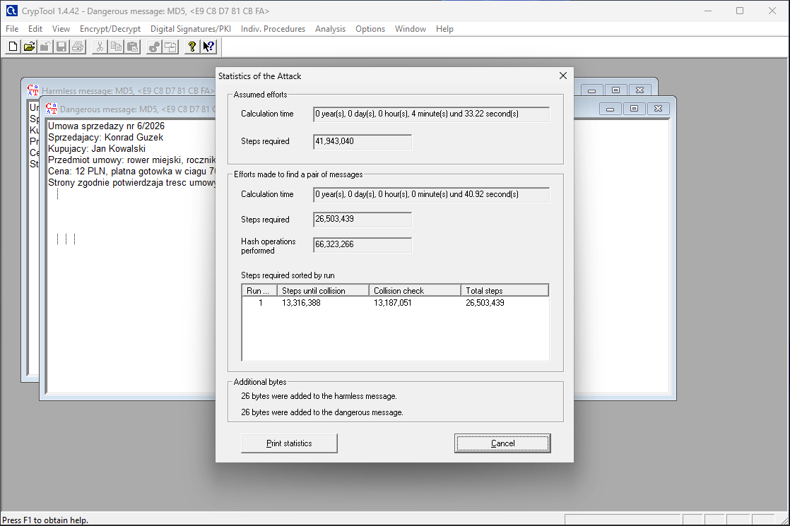
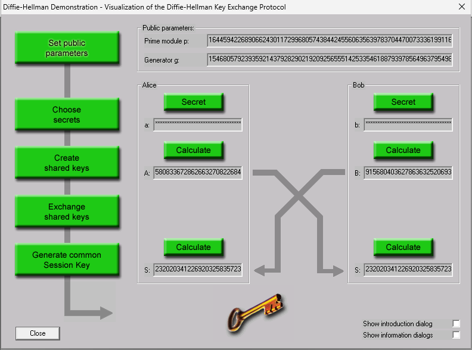

# Cyberbezpieczeństwo laboratorium

2026-11-17

Konrad Guzek grupa 8

## 1. Jednokierunkowe funkcje skrótu

### 1.1 Atak na wartość skrótu podpisu cyfrowego

W CrypTool 1.4.42 wybrano `Analysis/Hash/Attack on the Hash Value of the Digital Signature`. Atak polega na tym, że napastnik przygotowuje dwa dokumenty: „niewinny”, który ofiara chętnie podpisze, i „niebezpieczny”, pod którym chciałby mieć jej podpis. Program modyfikuje oba dokumenty bez zmiany ich widocznej treści i szuka pary wersji o takich samych pierwszych `n` bitach skrótu. Ponieważ podpisuje się skrót, a nie sam dokument, podpis złożony pod wersją niewinną pasowałby wtedy także do niebezpiecznej.

Oba dokumenty przygotowano samodzielnie (ASCII, po ok. 235 B) i różnią się tylko linią z ceną:

| Plik                       | Różniąca się linia                                                    |
| -------------------------- | --------------------------------------------------------------------- |
| `original.txt` (niewinny)  | `Cena: 1200 PLN, platna przelewem w ciagu 7 dni od podpisania umowy.` |
| `fake.txt` (niebezpieczny) | `Cena: 12 PLN, platna gotowka w ciagu 700 dni od podpisania umowy.`   |

Pozostałe linie są identyczne: `Umowa sprzedazy nr 6/2026`, strony umowy (`Konrad Guzek`, `Jan Kowalski`), przedmiot (`rower miejski, rocznik 2024`) i zdanie końcowe.

W opcjach ataku wybiera się funkcję skrótu (MD2, MD4, MD5, SHA, SHA-1, RIPEMD-160), liczbę znaczących bitów, które mają się zgadzać (1–128), oraz sposób modyfikacji dokumentów: wstawianie spacji (przed końcem linii lub podwójne spacje) albo dopisywanie znaków drukowalnych/niedrukowalnych. CrypTool wyszukuje kolizję metodą Floyda (cykl w ciągu skrótów), więc nie musi przechowywać wszystkich policzonych wartości, a po znalezieniu cyklu sprawdza, czy kolizja zachodzi między wersją niewinną i niebezpieczną; jeśli nie, zaczyna kolejny przebieg.

Przykład dla MD5 i 16 bitów (pierwsza próba): po dopisaniu po 10 B do każdego dokumentu oba skróty zaczynały się od `8A F0`. Program wykonał 838 kroków (2182 obliczenia skrótu) w dwóch przebiegach (350 + 203 i 156 + 129 kroków), wobec 640 kroków przewidywanych.

### 1.2 Wpływ parametrów

W tabelach podano wartości z okna `Statistics of the Attack`. „Kroki oczekiwane” to szacunek CrypTool, rzędu `2^(n/2)`, czas to faktyczny czas obliczeń podany przez program.

**MD5, różna liczba zgodnych bitów** (modyfikacja przez wstawianie spacji):

| Bity `n` | Kroki oczekiwane | Kroki wykonane | Obliczenia skrótu | Czas [s] | Dodane bajty (każdy dokument) | Wspólny początek skrótu |
| -------: | ---------------: | -------------: | ----------------: | -------: | ----------------------------: | ----------------------- |
|        8 |               40 |             12 |                32 |     0,00 |                             6 | `42`                    |
|       16 |              640 |            799 |             2 076 |     0,00 |                            10 | `3F CC`                 |
|       24 |           10 240 |         14 091 |            35 463 |     0,03 |                            14 | `ED 89 86`              |
|       32 |          163 840 |        251 790 |           643 431 |     0,38 |                            18 | `0E 59 6E 05`           |
|       40 |        2 621 440 |      4 828 621 |        13 268 101 |     7,30 |                            22 | `97 01 E8 9D 05`        |
|       48 |       41 943 040 |     26 503 439 |        66 323 266 |    40,92 |                            26 | `E9 C8 D7 81 CB FA`     |

**Różne funkcje skrótu, 32 bity:**

| Funkcja    | Długość pełnego skrótu | Kroki wykonane | Obliczenia skrótu | Czas [s] | Wspólny początek skrótu |
| ---------- | ---------------------: | -------------: | ----------------: | -------: | ----------------------- |
| MD2        |                    128 |        110 018 |           291 278 |    18,09 | `0A 17 E7 2D`           |
| MD4        |                    128 |        174 372 |           447 600 |     0,26 | `E0 E9 B2 9D`           |
| MD5        |                    128 |        251 790 |           643 431 |     0,38 | `0E 59 6E 05`           |
| SHA        |                    160 |        165 534 |           448 190 |     0,49 | `7D 2E D3 35`           |
| SHA-1      |                    160 |        283 401 |           716 841 |     0,37 | `0B D5 E5 83`           |
| RIPEMD-160 |                    160 |         20 770 |            60 975 |     0,10 | `ED 6E 06 86`           |

**Różne funkcje skrótu, 40 bitów** (kroki oczekiwane: 2 621 440 dla każdej funkcji, dodano po 22 B do każdego dokumentu):

| Funkcja    | Czas oczekiwany [s] | Kroki wykonane | Obliczenia skrótu |            Czas [s] | Wspólny początek skrótu |
| ---------- | ------------------: | -------------: | ----------------: | ------------------: | ----------------------- |
| MD2        |              257,85 |      5 546 371 |        14 040 381 | 967,98 (16 min 8 s) | `B3 6B 95 A5 1F`        |
| MD4        |               14,76 |      3 250 310 |         8 191 580 |                5,02 | `D6 76 6A 3E 1C`        |
| MD5        |               17,07 |      4 828 621 |        13 268 101 |                7,30 | `97 01 E8 9D 05`        |
| SHA        |               30,82 |      2 908 825 |         7 716 941 |                7,73 | `81 A5 C0 83 D0`        |
| SHA-1      |               27,56 |      6 035 098 |        15 658 920 |                8,24 | `99 6E C4 B8 14`        |
| RIPEMD-160 |               34,28 |     10 816 180 |        27 401 501 |               41,88 | `FA B1 3D 8B 77`        |

Czas oczekiwany CrypTool liczy z tej samej liczby kroków i zmierzonej szybkości danej funkcji, więc dobrze pokazuje jej koszt: MD4 i MD5 są najszybsze, SHA, SHA-1 i RIPEMD-160 ok. dwa razy wolniejsze, a MD2 kilkanaście razy wolniejsze od MD5. Faktyczny czas zależy też od szczęścia: RIPEMD-160 potrzebował ponad 4 razy więcej kroków niż oczekiwano, a SHA tylko nieco więcej. Dla MD2 przebiegi trwały tak długo, że atak zajął 16 minut.

**MD5, 32 bity, różne sposoby modyfikacji dokumentów** (w każdym wariancie dodano po 18 B):

| Modyfikacja                                      | Kroki wykonane | Obliczenia skrótu | Czas [s] | Wspólny początek skrótu |
| ------------------------------------------------ | -------------: | ----------------: | -------: | ----------------------- |
| wstawianie spacji (przed końcem linii, podwójne) |        251 790 |           643 431 |     0,38 | `0E 59 6E 05`           |
| dopisywanie znaków drukowalnych                  |         26 864 |            77 551 |     0,05 | `47 0C DF AA`           |
| dopisywanie znaków niedrukowalnych               |        681 507 |         1 717 162 |     1,02 | `22 41 1F 74`           |

Sposób modyfikacji nie zmienia oczekiwanej liczby kroków (163 840), decyduje tylko o tym, jak bardzo zmiana jest widoczna. Różnice w czasie wynikają z losowości przebiegów. Znaki drukowalne od razu widać w dokumencie, dlatego CrypTool oznacza ten tryb jako demonstracyjny. Spacje i znaki niedrukowalne są dla czytelnika praktycznie niewidoczne: w podglądzie wersji niebezpiecznej widać tylko kilka znaczników na końcu tekstu, a treść umowy wygląda tak samo.



### Wnioski (pytania 1.3 do 1.7)

**1.3.** Dzięki paradoksowi urodzin kolizję `n` bitów znajduje się średnio po ok. `2^(n/2)` obliczeniach skrótu, a nie po `2^n`. Każde 8 dodatkowych bitów mnoży więc pracę ok. 16 razy, czyli czas rośnie wykładniczo. Widać to w szacunkach CrypTool (40, 640, 10 240, 163 840, 2 621 440 kroków dla 8–40 bitów) i w pomiarach dla MD5: 0,03 s dla 24 bitów, 0,38 s dla 32 i 7,30 s dla 40 i 40,92 s dla 48 bitów (przy oczekiwanych 4 min 33 s). Rośnie też liczba bajtów dopisywanych do dokumentów (6, 10, 14, 18, 22 i 26 B), bo potrzeba więcej wariantów. Dla pełnego 128-bitowego skrótu MD5 taki ogólny atak urodzinowy wymagałby ok. `2^64` operacji.

**1.4.** Tak, ale tylko przez szybkość samej funkcji, bo potrzebna liczba kroków zależy od liczby porównywanych bitów, a nie od algorytmu. Przy 40 bitach CrypTool oczekiwał tej samej liczby kroków dla każdej funkcji, a szacowany czas wynosił 15–17 s dla MD4 i MD5, 28–34 s dla SHA, SHA-1 i RIPEMD-160 oraz 258 s dla MD2. Pojedynczy pomiar jest mocno losowy: liczba faktycznie wykonanych kroków wahała się od 1,1 do 4,1 wartości oczekiwanej. Dla pełnej długości skrótu ważniejsza jest jego długość (128 bitów dla MD, 160 dla SHA-1 i RIPEMD-160), bo ona wyznacza `2^(n/2)`.

**1.5.** Gdy modyfikuje się tylko jeden dokument, trzeba trafić w konkretny, z góry znany skrót drugiego (atak na drugi przeciwobraz), co wymaga ok. `2^n` prób. Gdy modyfikuje się oba, wystarczy dowolna para wersji o tym samym skrócie (kolizja), a z paradoksu urodzin wystarczy ok. `2^(n/2)` prób. Dla 40 bitów to ok. 10^6 zamiast 10^12 obliczeń, czyli różnica między sekundami a dniami. Napastnik musi jednak przygotować oba dokumenty i nakłonić ofiarę do podpisania swojej wersji niewinnej.

**1.6.** Wyniki nie podważają pełnych, nowoczesnych funkcji skrótu. Kolizje udało się znaleźć tylko dla 8–48 bitów, a dla 256-bitowego SHA-256 atak urodzinowy wymagałby `2^128` operacji. Pokazują natomiast, że skrót musi być dostatecznie długi (dziś co najmniej 256 bitów) i że nie można skracać go do kilkudziesięciu bitów. Nie należy też ufać funkcjom, dla których znane są ataki szybsze niż ogólny (MD2, MD4, MD5, SHA-0, SHA-1). Wyniki pokazują też, że modyfikacji dokumentu niewidocznych dla czytelnika (spacje, znaki niedrukowalne) jest dość, żeby wygenerować miliony wariantów, dlatego podpisywać trzeba tylko dokumenty przygotowane samemu lub sprawdzone na poziomie bajtów.

**1.7.** MD4 i MD5 są złamane: kolizje MD5 znajduje się w sekundach (Wang i in. 2004), a ataki z wybranym prefiksem pozwoliły stworzyć fałszywy certyfikat CA (2008) i zostały użyte przez malware Flame do podrobienia podpisu Microsoftu. MD2 ma znane ataki na przeciwobraz i kolizje lepsze od ogólnych. SHA-0 ma praktyczne kolizje, a dla SHA-1 opublikowano pierwszą praktyczną kolizję (SHAttered, dwa różne pliki PDF, 2017) i tańszy atak z wybranym prefiksem (Shambles, 2020), więc SHA-1 został wycofany z certyfikatów i podpisów. Funkcje MD i SHA-2 oparte na konstrukcji Merkle-Damgård są poza tym podatne na atak przedłużenia wiadomości (length extension), dlatego do MAC używa się HMAC. SHA-2 i SHA-3 nie mają znanych praktycznych ataków.

## 2. Wymiana klucza kryptograficznego

### 2.1 Demonstracja Diffiego-Hellmana w CrypTool

Wybrano `Indiv. Procedures/Protocols/Diffie-Hellman Demonstration` i przeszło się kolejno przez wszystkie kroki, za każdym razem używając wartości wygenerowanych przez CrypTool. Program wygenerował liczbę pierwszą bezpieczną `p = 2q+1` (gdzie `q` też jest pierwsza) o długości 256 bitów oraz generator `g`, a następnie losowe sekrety Alicji i Boba. Sekrety są w oknie zamaskowane gwiazdkami, a ich wartości podaje dopiero log z okna szczegółów klucza.

| Wartość             | Liczba                                                                           |
| ------------------- | -------------------------------------------------------------------------------- |
| `p`                 | `164459422689066243011729968057438442455606356397837044700733361991165383163799` |
| `g`                 | `154680579239359214379282902192092565551425335461887939785649637954980448390771` |
| `a` (sekret Alicji) | `18372565272133275958366845896420820129882710094161905256154395969653830107397`  |
| `b` (sekret Boba)   | `141009145814483715681595257851881128061629520202333450308463110244313653325668` |
| `A = g^a mod p`     | `58083367286266327082268446043260572285009494295779107212476172693029714811470`  |
| `B = g^b mod p`     | `91568040362786363252069307513290730779236586517311008270407553355444338542868`  |
| `S_A = B^a mod p`   | `23202034122692032583572309276381403980697277508002473713901017435560671909907`  |
| `S_B = A^b mod p`   | `23202034122692032583572309276381403980697277508002473713901017435560671909907`  |

Alicja i Bob wymienili tylko `A` i `B`, a mimo to obliczyli ten sam klucz sesji, który CrypTool zweryfikował komunikatem `Verification successful! - The keys of Alice and Bob are identical!` (klucz ma 254 bity). Przy 256-bitowym `p` demonstracja jest czytelna, ale za słaba do praktycznego użytku, dlatego w części 2.2 użyto 2048-bitowych parametrów z OpenSSL.



### 2.2 Wymiana kluczy w OpenSSL

Klientem 1 była maszyna Kali Linux (OpenSSL 3.6.5), a klientem 2 Ubuntu Server `ubuntu-server` (Ubuntu 24.04.5 LTS, OpenSSL 3.0.13). Między klientami przekazywano wyłącznie parametry DH i klucze publiczne.

**a–b.** Parametry wygenerował klient 1 poleceniem `openssl genpkey -genparam -algorithm DH -out dh_com_pub.pem` (ok. 2 s). Plik PEM:

```text
-----BEGIN DH PARAMETERS-----
MIIBDAKCAQEAyba8GQ1XwAJtbnr5K40kFiHXnGGrqpeRokgnsFcOTq9ibYUX2Gh7
5D/lsH5JtTft3etdzexn5DTqNzx+4MXQtN+DgUxzrFTdoN/Sp5tdtUu0ja1Z6ywT
cuTiWhza1syyYKbSfE9+rigkm9mepJdXPElYZuCcRK4WDIEteINcPi5S0Q/cv7g3
6Ujdt6HOHnqc+UtfBASdS0Tq9JjxTYLRYxlYqzuMNI3AXCwyaowIDxHYkkAIV207
hmgURpKsFKImf1ftdzhGYKr3zRA5CPBi9CfuJMKfTYix2OC0xxCgrjdtSwLsM42o
8mBrZXCNUc4//0hBy/zDZoyOKmuZ9xHObwIBAgICAOE=
-----END DH PARAMETERS-----
```

`openssl pkeyparam -in dh_com_pub.pem -text` pokazał parametry 2048-bitowe:

```text
DH Parameters: (2048 bit)
P:
    00:c9:b6:bc:19:0d:57:c0:02:6d:6e:7a:f9:2b:8d:
    24:16:21:d7:9c:61:ab:aa:97:91:a2:48:27:b0:57:
    ...
    3f:ff:48:41:cb:fc:c3:66:8c:8e:2a:6b:99:f7:11:
    ce:6f
G:    2 (0x2)
recommended-private-length: 225 bits
```

**c–d.** Każdy klient wygenerował z tych parametrów własny klucz (`openssl genpkey -paramfile dh_com_pub.pem`) i wyeksportował jego część publiczną (`openssl pkey -pubout`). `openssl pkey -text -noout` wypisuje klucz prywatny `x`, publiczny `y = g^x mod p` oraz te same `P` i `G`.

| Klient            | Początek klucza prywatnego    | Początek klucza publicznego      |
| ----------------- | ----------------------------- | -------------------------------- |
| 1 (Kali)          | `21:32:58:3b:06:c4:91:9f:...` | `00:b9:86:c5:4e:4c:0c:c2:4b:...` |
| 2 (ubuntu-server) | `6d:51:e9:d8:fe:0c:3f:e9:...` | `70:5b:b7:23:61:09:ab:3d:...`    |

Klucz publiczny klienta 1 w PEM (zawiera też `p` i `g`):

```text
-----BEGIN PUBLIC KEY-----
MIICJTCCARcGCSqGSIb3DQEDATCCAQgCggEBAMm2vBkNV8ACbW56+SuNJBYh15xh
...
/ybaTV8Q5AoIjCz7/1q2Be/vbYYbte+OYg==
-----END PUBLIC KEY-----
```

**e.** Po wymianie plików `dh_client1_pub_key.pem` i `dh_client2_pub_key.pem` każdy klient wyprowadził sekret swoim kluczem prywatnym i kluczem publicznym drugiej strony:

```text
klient 1: openssl pkeyutl -derive -inkey dh_client1_key.pem -peerkey dh_client2_pub_key.pem -out secret_key1.bin
klient 2: openssl pkeyutl -derive -inkey dh_client2_key.pem -peerkey dh_client1_pub_key.pem -out secret_key2.bin
```

**f–g.** `cmp secret_key1.bin secret_key2.bin` nie zgłosił różnic, oba pliki mają 256 B (2048 bitów, tyle co `p`), a `sha256sum` obu wynosi `026cfd0a258ad009410e0936e59348322f672ad7902455b1a951f1b7b8abb00f`. Zrzut `xxd secret_key1.bin` (identyczny dla `secret_key2.bin`):

```text
00000000: 203a 5278 147c 8918 f414 d741 030a 7024   :Rx.|.....A..p$
00000010: 9aa5 1535 f33d 4dd8 5592 1136 cad6 aad0  ...5.=M.U..6....
00000020: 1df6 73f5 e351 0a82 a8e7 bbd1 d6d6 859d  ..s..Q..........
00000030: 1f08 e19d 6848 a6c6 7872 6cdb da45 f46c  ....hH..xrl..E.l
00000040: b170 2a29 49a9 78d8 e8a3 e5ac 2981 a1b4  .p*)I.x.....)...
00000050: 6fde e535 5641 7f9b d2ea 6f0b 0295 8047  o..5VA....o....G
00000060: 2208 aba3 e7c8 9654 cca4 b93c 4056 560a  "......T...<@VV.
00000070: 677d 60de 1139 34cd 2c64 ccf2 5f56 f6fa  g}`..94.,d.._V..
00000080: 891c 1732 4ab3 0aa4 7881 c512 2cfa d933  ...2J...x...,..3
00000090: 55ee 5103 19fb 6ade ec6b e717 b792 8b0d  U.Q...j..k......
000000a0: ee4f 32ae 3ad9 f5ab e3b2 7cbf 9786 9fe2  .O2.:.....|.....
000000b0: 3f7f 41c1 bcc3 de4c 4005 6e41 0813 14b7  ?.A....L@.nA....
000000c0: 7f36 d09b 1996 a776 c0d0 b2b8 3b39 ab7f  .6.....v....;9..
000000d0: eb4b 9c47 cd60 149c aa4a e03b 6259 e58c  .K.G.`...J.;bY..
000000e0: 3d66 3266 625e 0add 7fdf 09ac a5c9 7e19  =f2fb^........~.
000000f0: df99 12dc 70d3 ef51 8941 0f3a 769b ca4b  ....p..Q.A.:v..K
```

### Wnioski (pytania 2.1 do 2.5)

**2.1.** Przy wymianie klucza przez RSA jedna strona losuje klucz sesyjny i szyfruje go kluczem publicznym drugiej. Jeśli klucz prywatny RSA serwera kiedyś wycieknie, napastnik, który nagrał ruch, odszyfruje wszystkie dawne klucze sesyjne. W DH, szczególnie efemerycznym (DHE/ECDHE, nowa para kluczy w każdej sesji), sekret nigdy nie jest przesyłany, a po sesji klucze prywatne są kasowane, więc wyciek klucza długoterminowego nie odsłania dawnych sesji (forward secrecy). Z tego powodu TLS 1.3 w ogóle zrezygnował z wymiany kluczy przez RSA i dopuszcza tylko (EC)DHE. Sam DH nie uwierzytelnia jednak stron, więc w praktyce łączy się go z podpisem (RSA, ECDSA) i certyfikatami.

**2.2.** Podstawowe ryzyko to atak man-in-the-middle: bez uwierzytelnienia kluczy publicznych napastnik może podstawić swój klucz każdej ze stron i uzgodnić osobny sekret z każdą z nich, a potem odszyfrowywać i przekazywać dalej cały ruch. Pozostałe zagrożenia to zbyt krótkie lub powszechnie używane parametry (atak Logjam na 512-bitowe grupy „export”, prekomputacja logarytmu dyskretnego dla popularnych 1024-bitowych `p`), słabe parametry lub podgrupy (atak small subgroup, gdy klient nie sprawdza otrzymanego klucza publicznego), słaby generator losowy klucza prywatnego oraz ponowne używanie tego samego klucza prywatnego, które odbiera forward secrecy. W naszym doświadczeniu klucze publiczne przekazano bez żadnego podpisu, więc taka wymiana byłaby podatna na MITM.

**2.3.** Inne metody to m.in.: ECDH (DH na krzywych eliptycznych, np. X25519, krótsze klucze przy tym samym bezpieczeństwie), wcześniej uzgodniony klucz współdzielony (PSK) i jego wyprowadzanie funkcjami KDF (HKDF, PBKDF2), protokoły z zaufaną trzecią stroną rozdającą klucze sesyjne (Kerberos, Needham-Schroeder), protokoły uzgadniania klucza na podstawie hasła (PAKE: SRP, SPAKE2, OPAQUE), postkwantowe mechanizmy enkapsulacji klucza (ML-KEM/Kyber, w TLS już w trybie hybrydowym z X25519), MQV/ECMQV, a także fizyczne przekazanie klucza lub kwantowa dystrybucja klucza (QKD, BB84).

**2.4.** Między klientami nie są przesyłane klucze prywatne `a` i `b` ani wynikowy sekret `g^(ab) mod p`. Przez sieć idą tylko parametry `p`, `g` oraz klucze publiczne `g^a mod p` i `g^b mod p`. Podsłuchujący musiałby z nich odzyskać `a` albo `b`, czyli rozwiązać problem logarytmu dyskretnego, co dla 2048-bitowego `p` jest obliczeniowo niewykonalne. Dzięki temu sekret nie może wyciec z kanału, a do jego ochrony wystarcza ochrona kluczy prywatnych na obu maszynach. Z drugiej strony brak przesyłania czegokolwiek tajnego nie chroni przed aktywnym napastnikiem (MITM z 2.2).

**2.5.** Tak, oba klienty uzyskały ten sam klucz: `cmp` nie zwrócił różnic, pliki mają po 256 B i ten sam skrót SHA-256 `026cfd0a…b8abb00f`. Uzgodniony tajny klucz (hex):

```text
203a5278147c8918f414d741030a70249aa51535f33d4dd855921136cad6aad0
1df673f5e3510a82a8e7bbd1d6d6859d1f08e19d6848a6c678726cdbda45f46c
b1702a2949a978d8e8a3e5ac2981a1b46fdee53556417f9bd2ea6f0b02958047
2208aba3e7c89654cca4b93c4056560a677d60de113934cd2c64ccf25f56f6fa
891c17324ab30aa47881c5122cfad93355ee510319fb6adeec6be717b7928b0d
ee4f32ae3ad9f5abe3b27cbf97869fe23f7f41c1bcc3de4c40056e41081314b7
7f36d09b1996a776c0d0b2b83b39ab7feb4b9c47cd60149caa4ae03b6259e58c
3d663266625e0add7fdf09aca5c97e19df9912dc70d3ef5189410f3a769bca4b
```
