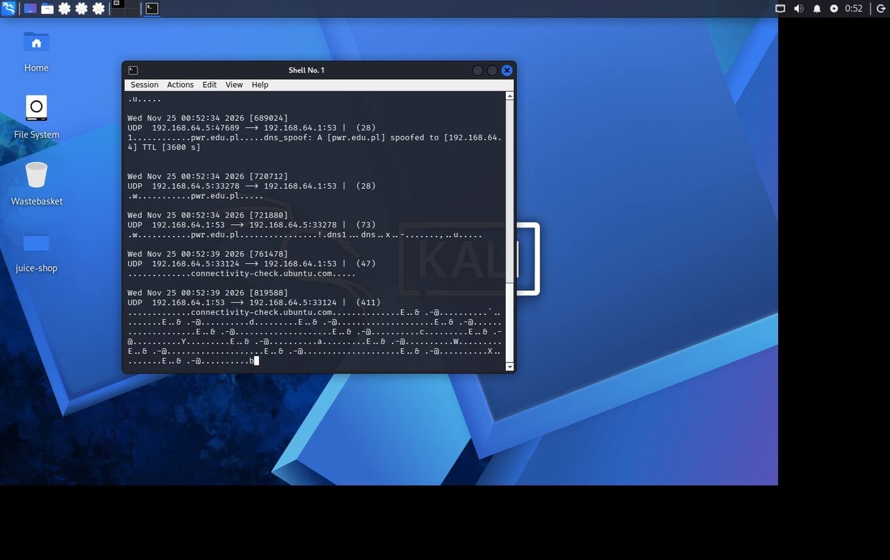
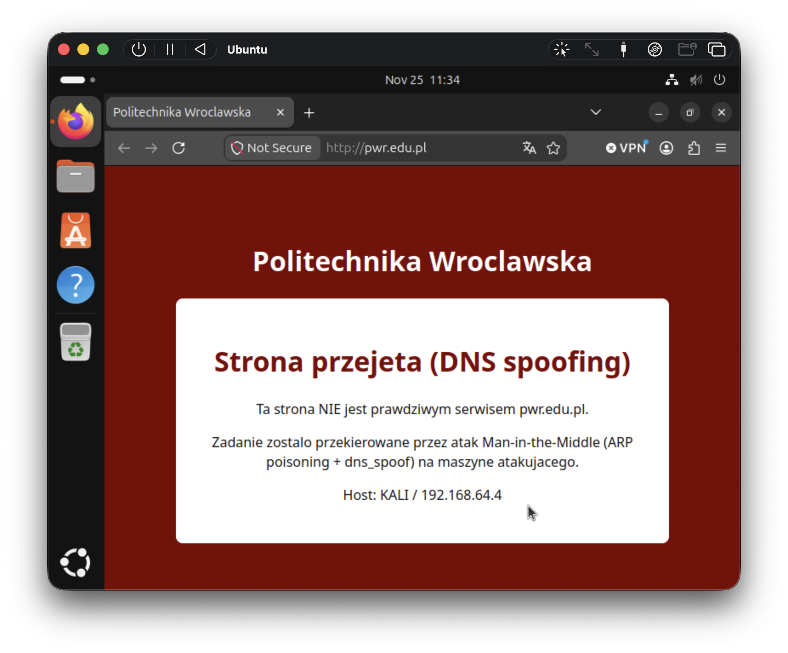
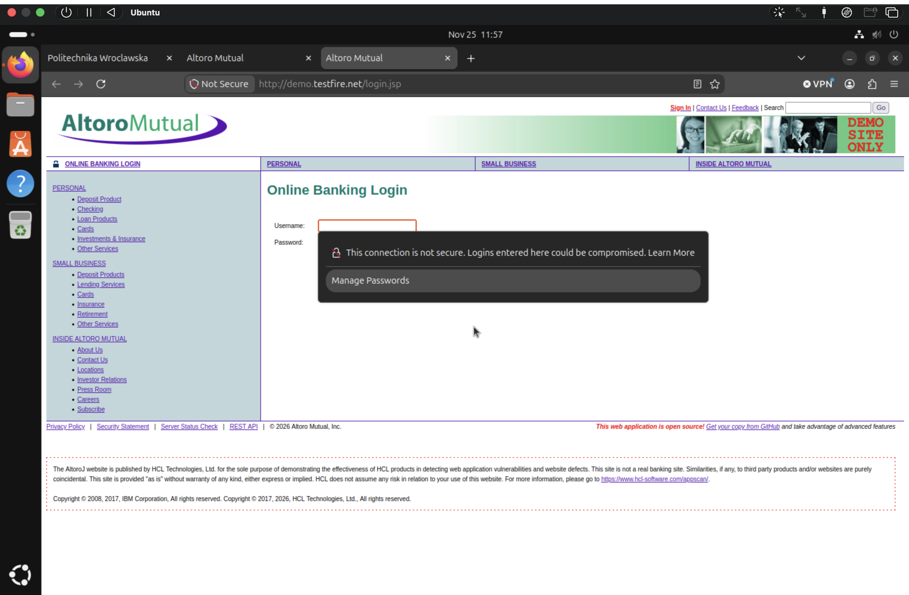
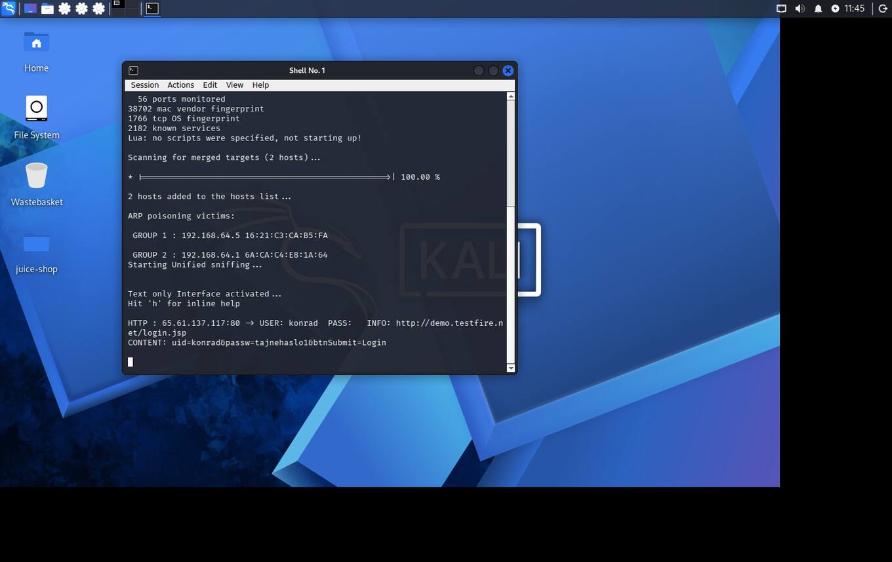
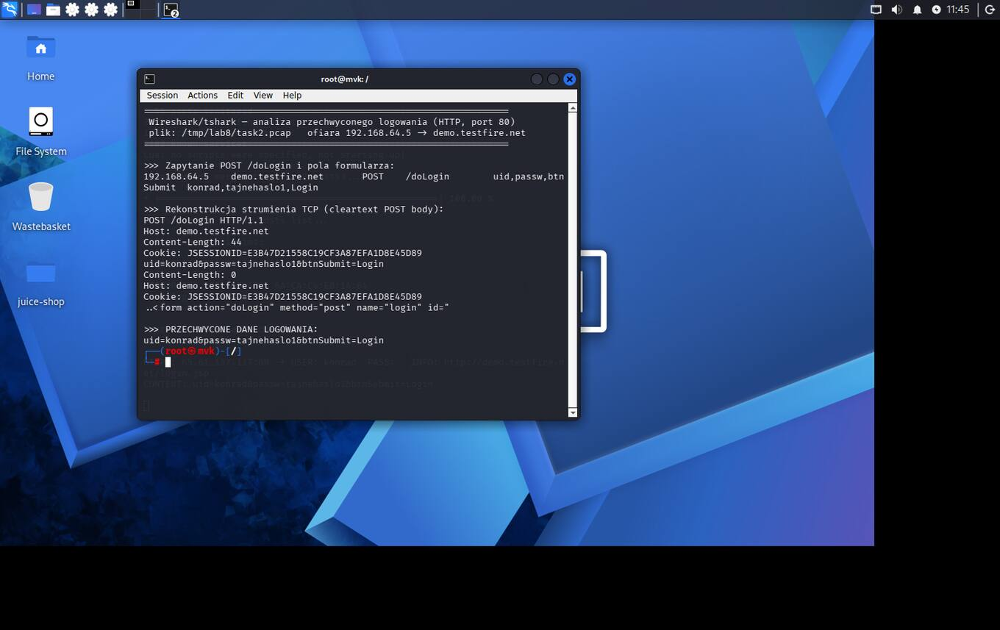

# Cyberbezpieczeństwo laboratorium

2026-11-25

Konrad Guzek grupa 8

## 1. Ataki na komunikację (Man-in-the-Middle)

Atak Man-in-the-Middle polega na tym, że atakujący ustawia się „pośrodku” komunikacji między dwoma urządzeniami i przechwytuje cały ruch, który między nimi płynie — może go odczytać, zmodyfikować lub zablokować. W laboratorium wykorzystano dwie techniki z tej grupy: zatrucie tablicy ARP (ARP poisoning) oraz fałszowanie odpowiedzi DNS (DNS spoofing).

### Środowisko

Atak przeprowadzono między dwiema maszynami wirtualnymi w tej samej sieci lokalnej (L2):

| Rola | Maszyna | Adres IP | Adres MAC |
| --- | --- | --- | --- |
| Atakujący | Kali Linux | `192.168.64.4` (eth0) | `b6:ba:6d:50:c6:03` |
| Ofiara | Ubuntu | `192.168.64.5` (enp0s1) | `16:21:c3:ca:b5:fa` |
| Brama / DNS | router | `192.168.64.1` | `6a:ca:c4:e8:1a:64` |

Na Kali włączono przekazywanie pakietów (`echo 1 > /proc/sys/net/ipv4/ip_forward`), aby po przejęciu ruchu ofiara nadal miała łączność — bez tego atak byłby zauważalny (brak internetu) i uniemożliwiłby obserwację wyniku. Narzędziem ataku jest **ettercap**, a do analizy przechwyconego ruchu — **Wireshark/tshark**.

## 2. Zadanie 1 — ARP poisoning + DNS spoofing

Celem jest przekierowanie ofiary wchodzącej na `pwr.edu.pl` na serwer WWW atakującego, który serwuje spreparowaną stronę.

### Przygotowanie na Kali (atakujący)

1. W pliku `/etc/ettercap/etter.dns` dodano wpisy fałszujące rekordy DNS domeny `pwr.edu.pl`, kierujące ją na adres Kali:

   ```
   pwr.edu.pl      A   192.168.64.4
   *.pwr.edu.pl    A   192.168.64.4
   www.pwr.edu.pl  PTR 192.168.64.4
   ```

2. Uruchomiono serwer `apache2`, który na `192.168.64.4` serwuje spreparowaną stronę „Politechnika Wrocławska / Strona przejęta”.

3. Uruchomiono ettercap z zatruwaniem ARP między bramą a ofiarą oraz z wtyczką `dns_spoof`. Ettercap wskazuje jako cele GROUP 1 = brama (`192.168.64.1`) i GROUP 2 = ofiara (`192.168.64.5`), po czym rozpoczyna nasłuch i aktywuje wtyczkę fałszującą DNS. Gdy ofiara wysyła zapytanie o `pwr.edu.pl`, ettercap odpowiada własnym sfałszowanym rekordem:

   ```
   dns_spoof: A [pwr.edu.pl] spoofed to [192.168.64.4] TTL [3600 s]
   ```



### Skutek po stronie ofiary

Zatrucie ARP spowodowało, że w tablicy ARP ofiary **adres bramy (`192.168.64.1`) wskazuje teraz na adres MAC Kali** (`b6:ba:6d:50:c6:03`) — cały ruch ofiary do bramy przechodzi więc przez atakującego:

| Wpis | Przed atakiem | W trakcie ataku |
| --- | --- | --- |
| `192.168.64.1` (brama) | `6a:ca:c4:e8:1a:64` | `b6:ba:6d:50:c6:03` (MAC Kali) |
| `pwr.edu.pl` (DNS) | `156.17.75.200` | `192.168.64.4` (Kali) |

Dzięki fałszowaniu DNS domena `pwr.edu.pl` rozwiązuje się u ofiary na adres Kali, więc przeglądarka ofiary wyświetla spreparowaną stronę zamiast prawdziwego serwisu uczelni:



Potwierdzeniem przejęcia jest dziennik serwera Apache na Kali, w którym widać żądania pochodzące z adresu ofiary (`192.168.64.5`), kierowane na sfałszowaną domenę:

```
192.168.64.5 - - [25/Nov/2026:00:54:26 +0100] "GET / HTTP/1.1" 200 800 "-" "Mozilla/5.0 (X11; Ubuntu; Linux x86_64; rv:154.0) Firefox/154.0"
```

Po zatrzymaniu ataku ettercap automatycznie przywraca prawdziwe wpisy ARP w tablicy ofiary (brama znów wskazuje na `6a:ca:c4:e8:1a:64`), a `pwr.edu.pl` ponownie rozwiązuje się na `156.17.75.200`.

## 3. Zadanie 2 — przechwycenie danych logowania

Celem jest przechwycenie loginu i hasła przesyłanych przez ofiarę podczas logowania na stronie działającej po nieszyfrowanym HTTP (`http://demo.testfire.net/login.jsp`).

### Przebieg

1. Na Kali uruchomiono ettercap z zatruwaniem ARP skierowanym tym razem na samą ofiarę (GROUP 1 = ofiara `192.168.64.5`, GROUP 2 = brama `192.168.64.1`) — bez wtyczki DNS, w trybie czystego podsłuchu.
2. Ofiara otworzyła w przeglądarce `http://demo.testfire.net/login.jsp` i zalogowała się dowolnymi danymi (`uid=konrad`, `passw=tajnehaslo1`).
3. Ponieważ strona używa czystego HTTP, cały ruch ofiary (strona logowania, arkusz CSS, obrazy, a przede wszystkim żądanie `POST /doLogin`) przeszedł przez maszynę atakującego.



Ettercap, dzięki wbudowanemu dekoderowi HTTP, od razu wypisał przechwycone dane logowania w czytelnej postaci:

```
HTTP : 65.61.137.117:80 -> USER: konrad  PASS:   INFO: http://demo.testfire.net/login.jsp
CONTENT: uid=konrad&passw=tajnehaslo1&btnSubmit=Login
```



### Analiza w Wireshark/tshark

Ruch został równolegle zapisany do pliku `.pcap` i przeanalizowany w Wireshark/tshark. Rekonstrukcja strumienia TCP pokazuje pełne żądanie `POST /doLogin` wraz z treścią formularza przesłaną otwartym tekstem:

```
POST /doLogin HTTP/1.1
Host: demo.testfire.net
Content-Length: 44
Cookie: JSESSIONID=E3B47D21558C19CF3A87EFA1D8E45D89

uid=konrad&passw=tajnehaslo1&btnSubmit=Login
```



Eksperyment pokazuje, że przy nieszyfrowanej komunikacji HTTP atakujący w pozycji MitM odczytuje login i hasło bez żadnego dodatkowego nakładu — jedyną skuteczną ochroną jest szyfrowanie transportu (HTTPS/TLS).

Po zakończeniu obu zadań atak MitM został zatrzymany, a tablice ARP ofiary przywrócone do stanu pierwotnego.

## 4. Problemy i pytania

**I. Jaka jest różnica między aktywnymi i pasywnymi atakami MitM?**

Atak **pasywny** polega wyłącznie na podsłuchiwaniu komunikacji — atakujący odczytuje przesyłane dane, ale ich nie zmienia i nie ingeruje w ruch (np. nasłuch w otwartej sieci Wi-Fi albo na porcie lustrzanym przełącznika). Jest trudny do wykrycia, bo nie zostawia śladów w ruchu, lecz ogranicza się do poufności — napastnik nie może niczego zmodyfikować. Atak **aktywny** oznacza, że atakujący nie tylko czyta, ale też aktywnie uczestniczy w komunikacji: przekierowuje ją do siebie (np. przez ARP poisoning czy DNS spoofing), może modyfikować treść, wstrzykiwać własne pakiety, podmieniać strony lub przerywać połączenie. Daje większe możliwości, ale generuje nietypowy ruch (np. zduplikowane odpowiedzi ARP), więc jest łatwiejszy do wykrycia. W tym laboratorium oba zadania to ataki aktywne — ruch ofiary był fizycznie przekierowywany przez maszynę atakującego.

**II. Jak zabezpieczyć swoją sieć przed atakami zatruwania ARP?**

- **Statyczne wpisy ARP** dla krytycznych adresów (np. bramy) — ręcznie przypisany MAC nie zostanie nadpisany fałszywą odpowiedzią ARP.
- **Dynamic ARP Inspection (DAI)** na przełącznikach zarządzalnych — przełącznik weryfikuje pakiety ARP względem tablicy DHCP snooping i odrzuca sfałszowane.
- **DHCP snooping i Port Security** — ograniczenie, które porty i adresy MAC są dopuszczone.
- **Segmentacja sieci (VLAN)** — zmniejsza zasięg ataku do pojedynczej domeny rozgłoszeniowej.
- **Oprogramowanie wykrywające** nietypowe zmiany w tablicy ARP (np. arpwatch, XArp).
- **Szyfrowanie warstwy wyższej (HTTPS, VPN, SSH)** — nie zapobiega samemu zatruciu ARP, ale sprawia, że przechwycony ruch jest dla atakującego bezużyteczny.

**III. Dlaczego ważne jest, aby używać rozszerzeń DNSSEC w celu zapobiegania atakom polegającym na fałszowaniu DNS?**

Zwykły DNS nie uwierzytelnia odpowiedzi — klient przyjmuje pierwszą pasującą odpowiedź, więc atakujący (jak w zadaniu 1) może podstawić własny, fałszywy rekord i przekierować ofiarę na dowolny adres IP. **DNSSEC** dodaje do rekordów DNS podpisy kryptograficzne, tworząc łańcuch zaufania od strefy głównej w dół. Resolver weryfikuje podpis każdej odpowiedzi kluczem publicznym strefy; jeżeli rekord został sfałszowany lub zmodyfikowany po drodze, podpis się nie zgadza i odpowiedź jest odrzucana. Dzięki temu DNSSEC zapewnia **integralność i autentyczność** odpowiedzi DNS, co bezpośrednio neutralizuje DNS spoofing i zatruwanie cache. (DNSSEC nie zapewnia natomiast poufności — zapytania nadal są jawne; do tego służą DoH/DoT.)

**IV. Co to jest tryb monitorowania i jak można go używać do podsłuchiwania komunikacji sieciowej?**

**Tryb monitorowania (monitor mode)** to tryb pracy bezprzewodowej karty sieciowej, w którym karta odbiera **wszystkie** ramki radiowe 802.11 w zasięgu, niezależnie od tego, do kogo są adresowane i bez konieczności łączenia się z punktem dostępowym. Różni się od trybu „promiscuous” (który działa po skojarzeniu z siecią, w warstwie 2 ethernetu) tym, że przechwytuje surowy ruch radiowy, łącznie z ramkami zarządzającymi i kontrolnymi. Używa się go, uruchamiając kartę w trybie monitora (np. `airmon-ng start wlan0`) i przechwytując ruch narzędziami takimi jak Wireshark, tcpdump czy airodump-ng. Pozwala to na pasywny podsłuch sieci Wi-Fi: analizę ruchu, wykrywanie sieci i klientów, a w przypadku ruchu nieszyfrowanego — odczyt jego treści (ruch zaszyfrowany, np. WPA2, wymaga dodatkowo znajomości klucza). Jest podstawą pasywnych ataków MitM w sieciach bezprzewodowych oraz testów bezpieczeństwa sieci Wi-Fi.
